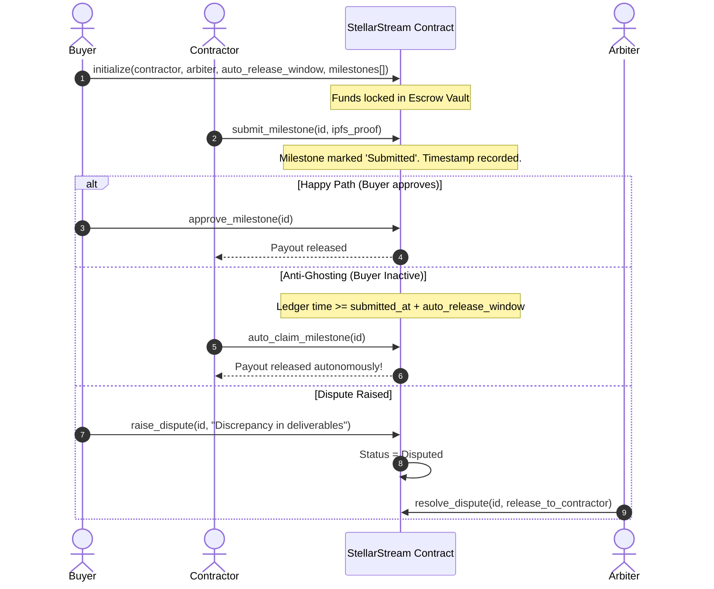

# Project 1: StellarStream Escrow

> **Autonomous Milestone Smart Vault with Anti-Ghosting Timelocks on Stellar & Soroban**

[](https://stellar.org/soroban)
[](https://stellar.org)
[](https://react.dev)
[](https://vitejs.dev)

---

## 1. Problem Statement & Research
Traditional freelance escrows (and basic Web3 two-party escrow GitHub repositories) suffer from two major flaws:
1. **The Ghosting Problem**: A contractor delivers the milestone proof, but the client vanishes or stays inactive. Funds remain perpetually locked in limbo unless expensive third-party arbitration is invoked.
2. **All-or-Nothing Capital Risk**: Contracts lock the full budget without stage-gated accountability.

## 2. The Innovation ("A Bit Different")
**StellarStream Escrow** introduces:
- **Autonomous Anti-Ghosting Timelock**: When a contractor submits deliverable hashes (e.g. IPFS CIDs or git commit proofs), an on-chain countdown starts (`auto_release_window`). If the buyer neither approves nor files a dispute within that window, the contractor can execute `auto_claim_milestone` autonomously on-chain.
- **Granular Multi-Stage Milestones**: Each milestone holds independent values, descriptions, states, and proofs.
- **Built-in Tripartite Arbitration**: Disputed milestones can be independently adjudicated by a designated arbiter without freezing unaffected milestones.

---

## 3. Architecture



---

## 4. Smart Contract Details (`contracts/stellarstream_escrow`)
- **Language**: Rust (`soroban-sdk`)
- **Core Functions**:
  - `initialize(buyer, contractor, arbiter, auto_release_window, milestone_amounts, milestone_titles)`
  - `submit_milestone(contractor, milestone_id, evidence_hash)`
  - `approve_milestone(buyer, milestone_id)`
  - `auto_claim_milestone(contractor, milestone_id)`
  - `raise_dispute(sender, milestone_id, reason)`
  - `resolve_dispute(arbiter, milestone_id, release_to_contractor)`
  - `get_state()` / `get_milestones()`

### Running Contract Tests
```bash
cd contracts
cargo test
```

### Compiling to WebAssembly (Wasm)
```bash
cargo build --target wasm32-unknown-unknown --release
```

---

## 5. Web3 Frontend (`frontend/`)
- Built with **React 18**, **TypeScript**, **Vite**, **Tailwind CSS**, and **Lucide Icons**.
- Supports switching between simulated live actor roles (**Buyer**, **Contractor**, **Arbiter**) to interactively test all state transitions.
- Displays live vault balance, milestone pipelines, proof verifications, and real-time ledger simulation logs.

### Running Frontend
```bash
cd frontend
npm install
npm run dev
```

### Building for Production
```bash
npm run build
```
